# rabbit-hole

A mobile-first learning app built around a **map**. All of mathematics sits on one screen as zoomable
circles; you tap into a subject, see what is inside it, and work through short courses written to a strict
format: one small step at a time, typed answers checked on the phone, hints before answers, pictures you can
drag. Claude Code writes the courses, either as files you commit or from inside the app by talking to it.

<table><tr>
<td align="center" valign="top">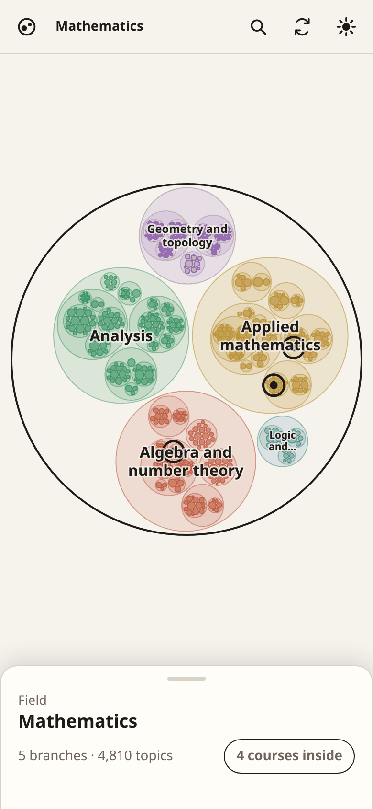<br><sub>The whole of maths</sub></td>
<td align="center" valign="top">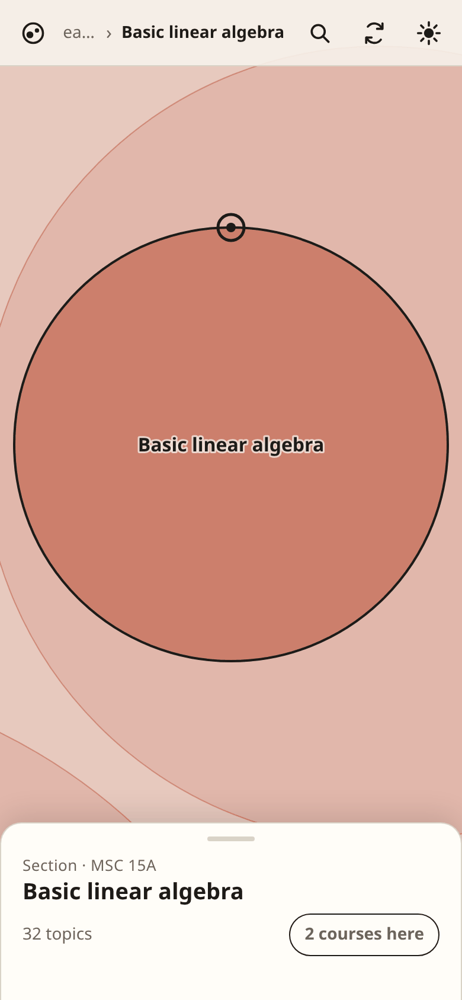<br><sub>Zoomed in on a section</sub></td>
<td align="center" valign="top">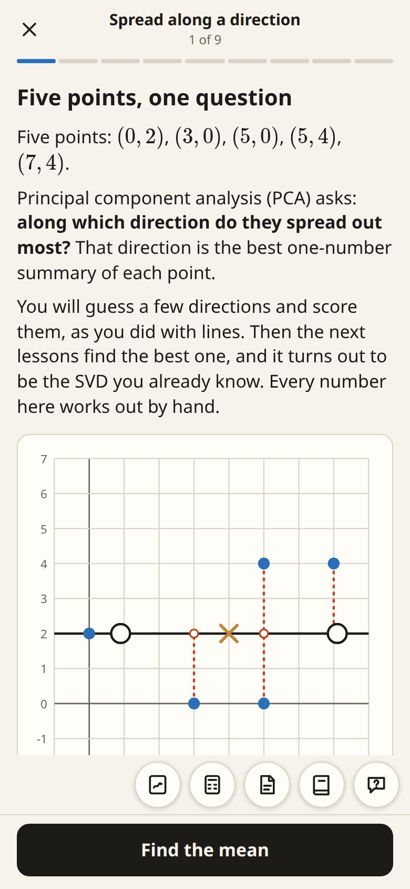<br><sub>A lesson screen</sub></td>
</tr></table>

**Try it without installing anything:** the no-AI version is published at
https://markharley12.github.io/rabbit-hole/ (once the repository is public and Pages is enabled).

It is a personal project built around its author's setup (Claude Code on a PC, the phone reaching it over
Tailscale), so it is not turnkey for everyone, but everything below runs on any Linux or macOS machine.
The plan is in [docs/PLAN.md](docs/PLAN.md), the roadmap in [docs/ROADMAP.md](docs/ROADMAP.md).

## Features

### The map

All of mathematics (the MSC2020 classification: 593 nodes, 517 sections, 4,810 topics) as nested circles,
sized by topic count, one colour per branch. A circle that has a course inside is ringed. One tap zooms in and
opens a sheet with where the node sits, its topics, the courses on it, what a course builds on and leads to,
and outside reading links. Light and dark follow the system, or the button at the top right.

<table><tr>
<td align="center" valign="top"><br><sub>Home: five branches</sub></td>
<td align="center" valign="top">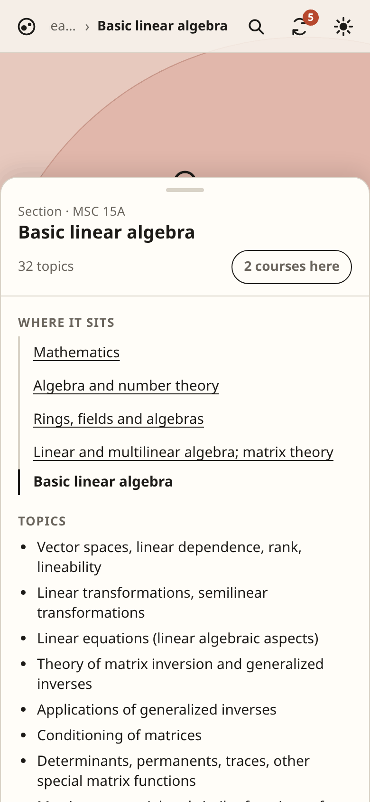<br><sub>A node's sheet</sub></td>
<td align="center" valign="top">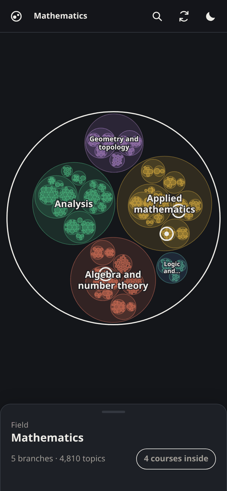<br><sub>Dark mode</sub></td>
</tr></table>

### Finding courses

The search button opens the Courses menu: every course with your progress, and a search over courses, sections
and topics. "Where I am" shows the next action, counts per course and the slips you have made twice. Counts are
never scores: an unassessed topic has no score, and a blank is not a zero.

<table><tr>
<td align="center" valign="top">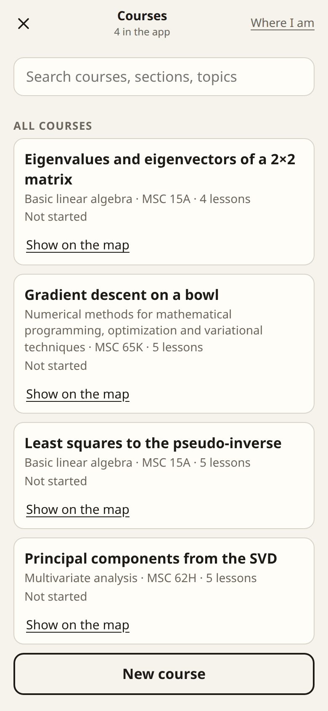<br><sub>Courses</sub></td>
<td align="center" valign="top">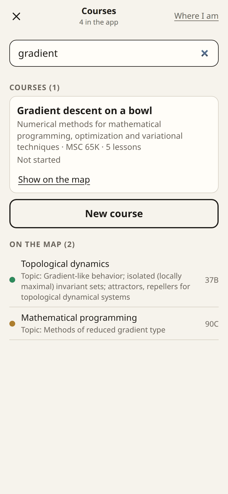<br><sub>Search</sub></td>
<td align="center" valign="top">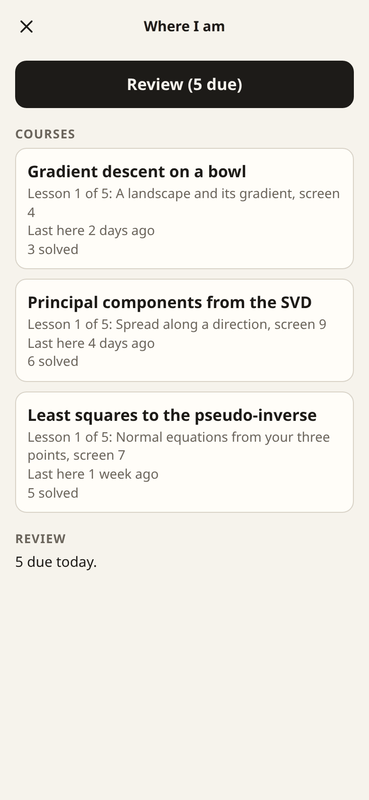<br><sub>Where I am</sub></td>
</tr></table>

### Lessons

A lesson is a run of screens. The main kind is a **step**: a definition, why it matters, a prompt, a typed answer,
three hints, a "check it yourself", and one clear next action. Answers are parsed as maths (fractions, powers, roots,
matrices), and a set of deterministic slip detectors names common mistakes (a sign, swapped entries, a known wrong
value) instead of just saying "wrong". **Quiz** screens explain why every option is right or wrong, and **order**
puzzles ask you to put a derivation in sequence.

<table><tr>
<td align="center" valign="top">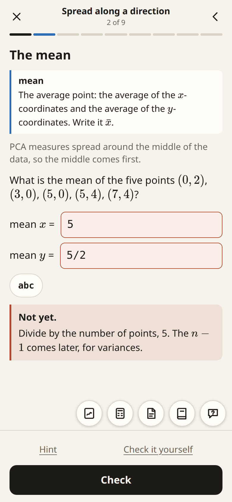<br><sub>A named slip</sub></td>
<td align="center" valign="top">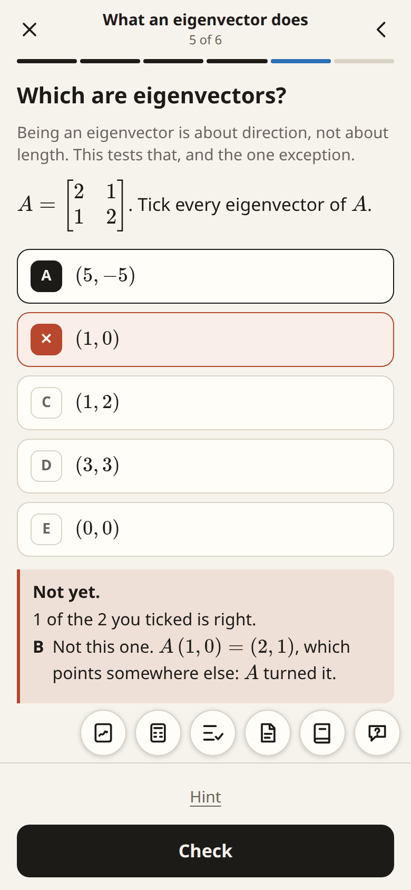<br><sub>A quiz question</sub></td>
<td align="center" valign="top">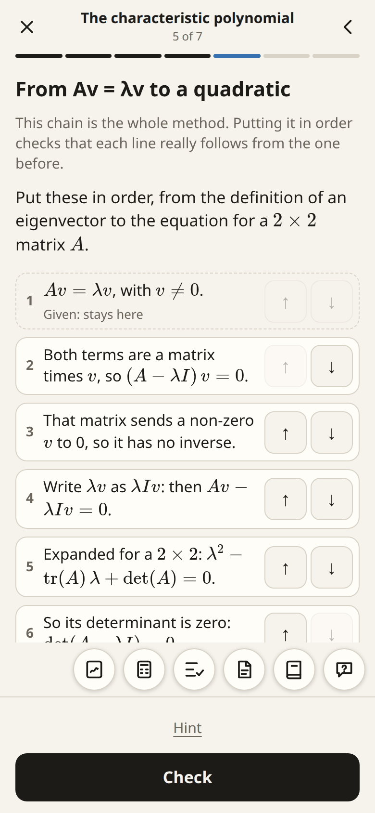<br><sub>An order puzzle</sub></td>
</tr></table>

### Interactive pictures

Vetted widgets, never generated code: a line fitter, dependent columns, SVD geometry, a PCA scatter you can drag,
and a descent path on a bowl.

<table><tr>
<td align="center" valign="top"><br><sub>PCA scatter</sub></td>
<td align="center" valign="top">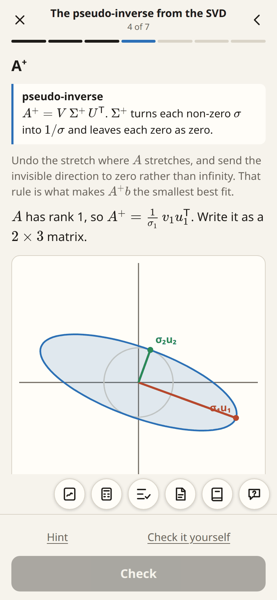<br><sub>SVD geometry</sub></td>
<td align="center" valign="top">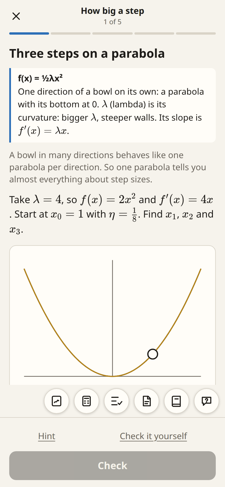<br><sub>Gradient descent</sub></td>
</tr></table>

### Lesson tools

Round buttons at the right of every lesson open an overlay without losing your place; Escape, a tap outside or the
phone's back button closes it.

<table><tr>
<td align="center" valign="top">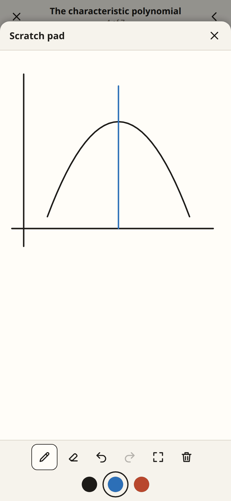<br><sub>Scratch pad: draw, erase, undo</sub></td>
<td align="center" valign="top">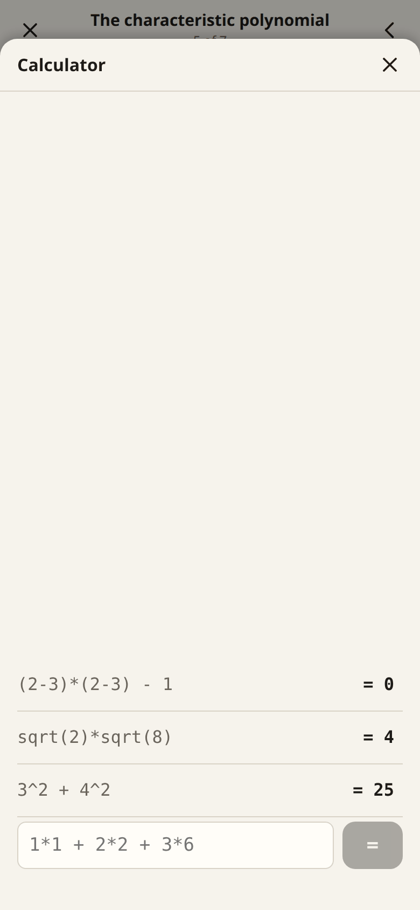<br><sub>Calculator with a tape</sub></td>
<td align="center" valign="top">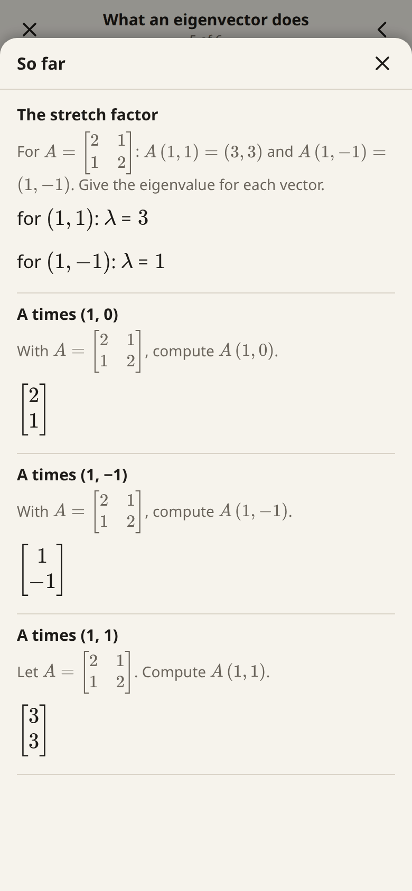<br><sub>So far: earlier answers</sub></td>
</tr></table>

<table><tr>
<td align="center" valign="top">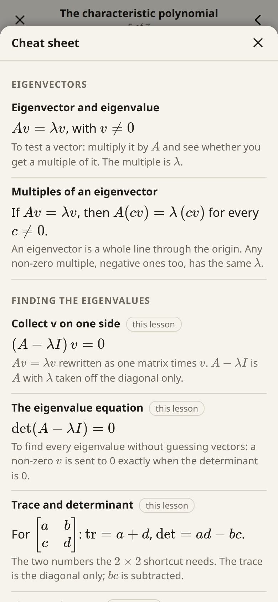<br><sub>Cheat sheet and your notes</sub></td>
<td align="center" valign="top">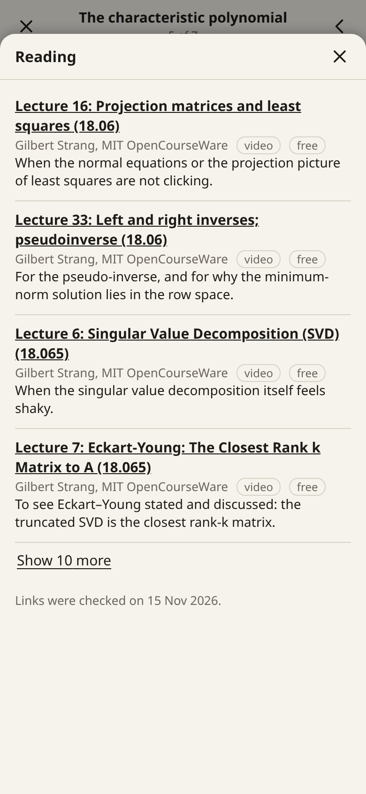<br><sub>Reading links</sub></td>
<td align="center" valign="top">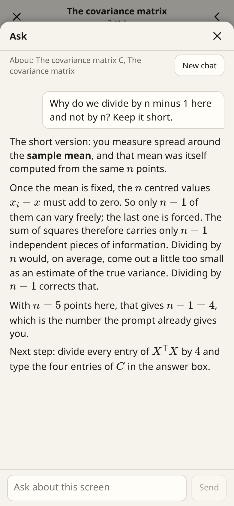<br><sub>Ask: a tutor that knows the step</sub></td>
</tr></table>

- **Scratch pad**: one finger draws, two pan and pinch; saved per lesson on the device.
- **Calculator**: keeps the last 20 lines; tap a result to reuse it.
- **So far**: the answers to steps you already solved, so you stop paging back for constants.
- **Cheat sheet**: the course's formulas, with "this lesson" marked, and **My notes** that stay on your device.
- **Reading**: outside links attached to the course's node and its ancestors.
- **Ask** (needs the AI server): a chat that already knows the course, the step and what you have typed.

### Spaced review

Steps marked for review come back on a 1, 3, 7, 16, 35, 90 day ladder (good / hard / again) in interleaved
sessions of at most ten, and cheat-sheet formulas become recall cards. The top bar shows how many are due.

<table><tr>
<td align="center" valign="top">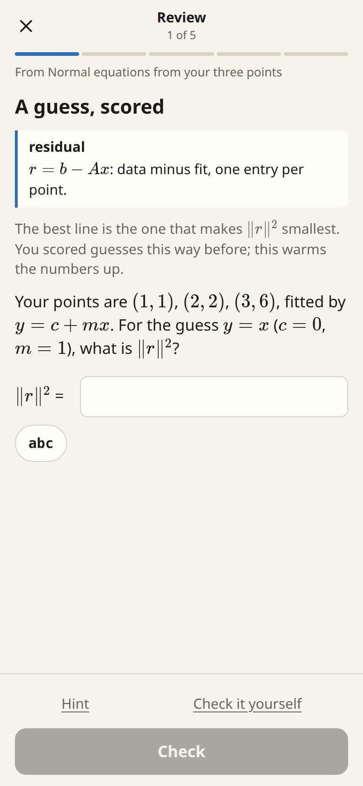<br><sub>A review card</sub></td>
<td align="center" valign="top"><br><sub>Review due in Where I am</sub></td>
</tr></table>

### Make a course by talking

With the AI server running, **New course** in the Courses menu (or **Make a course here** on an empty node) opens
a chat that asks one question at a time and writes a brief. **Build this** hands the brief to a Claude Code job that
writes the course, checks it with the validator, repairs it up to three times and publishes it into the app.

<table><tr>
<td align="center" valign="top">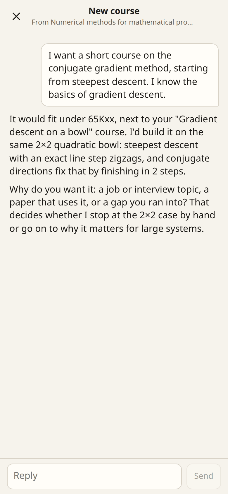<br><sub>Planning a course</sub></td>
<td align="center" valign="top"><br><sub>Ask inside a lesson</sub></td>
</tr></table>

### Everything else

Works offline once installed (PWA, with an **Update** bar when a new build waits); progress, drafts, notes and
review state live only on your device (`localStorage`); a course can be shared as one `.rhpack` file; every answer
key is re-derived with sympy before a course can reach the app.

## Install

You need **Node 22+**, **Python 3** and **git**. For the AI features you also need the
[Claude Code](https://claude.com/claude-code) CLI signed in (`claude auth status` shows `"loggedIn": true`). There
are no API keys anywhere; all AI goes through your own `claude` CLI.

```bash
git clone https://github.com/markharley12/rabbit-hole.git
```

```bash
cd rabbit-hole
```

```bash
npm install
```

The course validator needs two Python packages (the map build and the server use the standard library only).
Modern Linux distributions refuse a global `pip install`, so use a virtual environment and keep it activated
whenever you run `npm run` commands:

```bash
python3 -m venv .venv
```

```bash
source .venv/bin/activate
```

```bash
pip install -r requirements.txt
```

## Run it

Development server with hot reload (it validates and publishes the courses first):

```bash
npm run dev
```

Open the address it prints. To try it as a phone would, use your browser's device mode.

A production build, served by the AI server, which also serves the built app on `http://127.0.0.1:8791`:

```bash
npm run build
```

```bash
npm run server
```

Without the server the app is unchanged and the Ask and New course buttons are simply not there.

## Without the AI server

The AI server is optional. The app asks `./api/state` on load; if nothing answers, the **Ask** tool and **New course**
disappear and everything else works unchanged: the map, lessons, typed-answer checking, widgets, scratch pad,
calculator, So far, cheat sheets, reading links, review and Where I am. Any static host will do for this mode:
`npm run build`, then serve the `dist` folder. The build uses relative paths, so it also works under a sub-path.

Note that `npm run dev` proxies `/api` to port 8791, so if the server happens to be running the dev page will show
the AI features too.

**GitHub Pages.** [.github/workflows/pages.yml](.github/workflows/pages.yml) runs the checks, builds, and publishes the
no-AI app on every push to `main`, at `https://<your-github-name>.github.io/<repo-name>/`. Once, in the repository's
Settings, Pages, set Source to **GitHub Actions**. Progress and notes are stored in each visitor's own browser.

## Check everything

Typecheck, lint, app tests, tool tests, server tests, and course validation (schema, widgets, and every answer key
re-derived with sympy):

```bash
npm run check
```

## Add or change courses

Courses live in `content/<field>/courses/<course-id>/`; the contract is [docs/course-authoring.md](docs/course-authoring.md).
`npm run validate` checks them; `npm run courses` also publishes them into `public/` (gitignored). Invalid content never
reaches the app. Or just ask for one from inside the app, as above.

The map data is committed. To rebuild it you need the author's [TreeQuiz](https://github.com/markharley12/TreeQuiz)
dataset checked out at `~/git/TreeQuiz`:

```bash
npm run build:map
```

## Course packs

A course lives in `content/<field>/courses/<course-id>/` (the folder is named after the course's
`id`; any number of courses can hang on one map node). A pack is one `.rhpack` file holding a
course, so you can send one to someone else. Packing refuses a course that fails validation.
Packs land in `dist-packs/` (not in git):

```bash
npm run pack -- pack least-squares-to-the-pseudo-inverse
```

Unpacking treats the file as untrusted: it checks the manifest and every hash, accepts only plain
`.json` files, validates the course, and only then writes it to `content/`. It will not replace a
course you already have unless you add `--force`:

```bash
npm run pack -- unpack dist-packs/least-squares-to-the-pseudo-inverse.rhpack
```

Then `npm run courses` publishes it to the app.

## On a phone

Build, then serve the `dist` folder over HTTPS. The author serves it to his own devices over
Tailscale, on a port of its own so it shares no origin (caches, storage) with anything else:

```bash
npm run build
```

```bash
tailscale serve --bg --https=8443 "$PWD/dist"
```

Open `https://<machine>.<tailnet>.ts.net:8443/` on the phone and use the browser's "Install
app" / "Add to Home Screen". After that it opens offline. The serve setting survives reboots;
`tailscale serve --https=8443 off` removes it. After a new `npm run build`, the phone picks the
update up the second time the app is opened (the new version waits until the old one is closed).
To see which build is running, open the sheet on the home view: "This version" gives the build
time and commit.

## The AI server

`server/rabbit_server.py` (Python standard library only) serves the built app **and** a small API
that runs Claude Code sessions (`claude -p`, the owner's plan, no API keys) for the **Ask** tool on
a lesson screen: a chat that already knows the course, the step, and what has been typed and tried.
It binds `127.0.0.1` only. The design is in [docs/ai-sessions.md](docs/ai-sessions.md); the tutor's
instructions are [docs/agents/ask.md](docs/agents/ask.md). Without the server the app is unchanged
and the Ask button is simply not there.

The Claude Code CLI must be signed in on the PC (`claude auth status` says `"loggedIn": true`).

Build, then start the server (port 8791 by default):

```bash
npm run build
```

```bash
npm run server
```

To reach it from the phone, switch port 8443 from serving the `dist` folder to proxying the server
(the server then serves the app as well, so app and API share one origin):

```bash
tailscale serve --bg --https=8443 http://127.0.0.1:8791
```

To keep it running, install the systemd user unit (check the paths in it first):

```bash
mkdir -p ~/.config/systemd/user
```

```bash
cp server/rabbit-hole.service ~/.config/systemd/user/
```

```bash
systemctl --user daemon-reload
```

```bash
systemctl --user enable --now rabbit-hole.service
```

During development, `npm run dev` proxies `/api` to a running `npm run server`. The server's
tests never run the real `claude` (`npm run test:server`, part of `npm run check`). One hand-run
check with the real CLI, two short Sonnet turns:

```bash
env -u PYTHONPATH python3 server/smoke_ask.py --port 8791
```

Session records (the chats) are kept in `data/sessions/`, which is not in git.

**Making a course by talking.** With the server running, the Courses menu ends with **New course**
and an empty node's sheet offers **Make a course here**. That opens a chat (kind `new-course`,
Sonnet, may search the web) that asks one question at a time and, when the shape is clear, writes a
brief to `data/drafts/<id>/brief.md`. The app shows the brief with **Build this**. The build (kind
`build-course`, Opus) runs in the background and writes only the new folder
`content/maths/courses/<course-id>/`; the server then runs the validator, sends problems back up to
three times, publishes, and copies the result into `dist/content/`. A course that never passes is
moved to `data/drafts/<id>/failed-course/`. Built courses stay uncommitted. Prompts:
[docs/agents/new-course.md](docs/agents/new-course.md), [docs/agents/build-course.md](docs/agents/build-course.md).
It passed against the real CLI on 16 Nov 2026 (a four-lesson course in 9 minutes). The hand-run check with the real CLI (the build
is long and uses Opus):

```bash
env -u PYTHONPATH python3 server/smoke_new_course.py --port 8791
```

```bash
env -u PYTHONPATH python3 server/smoke_new_course.py --port 8791 --build
```

## Attribution and licence

The first map is built from the [MSC2020](https://msc2020.org) Mathematics Subject
Classification by zbMATH Open and Mathematical Reviews, under
[CC BY-NC-SA 4.0](https://creativecommons.org/licenses/by-nc-sa/4.0/), via the curated tree in
the author's [TreeQuiz](https://github.com/markharley12/TreeQuiz).

The code is MIT licensed ([LICENSE](LICENSE)). The map data (`public/content/maths/map.json`) is derived
from MSC2020 and stays under CC BY-NC-SA 4.0, so the repository as a whole is for non-commercial use.
The course content in `content/` was written with Claude Code.
